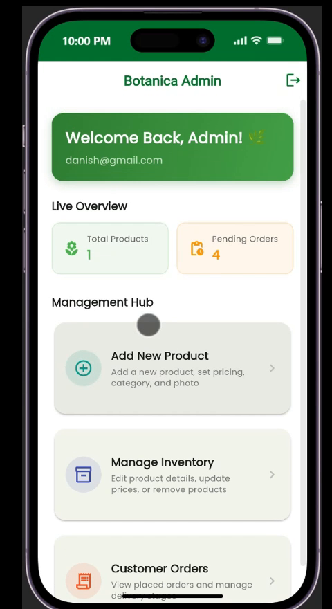
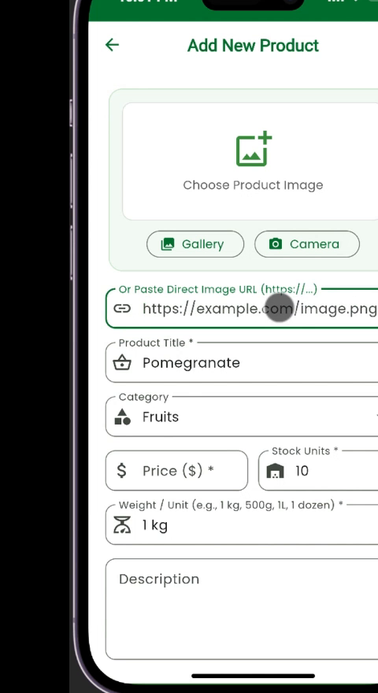
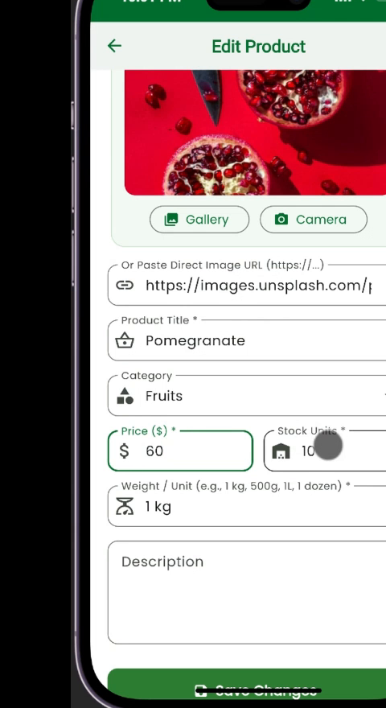
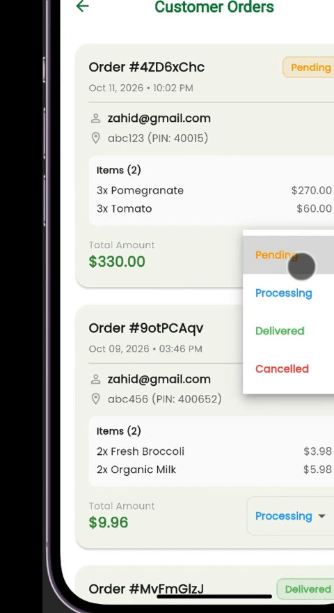

# Botanica Admin App

<div align="center">

# 🌿 BOTANICA
### Two Apps. One Connected Grocery Experience.

[](assets/media/botanica_connected_apps_30s.mp4)

**[▶ Click to View Full 1080p HD Video with Audio (botanica_connected_apps_30s.mp4)](assets/media/botanica_connected_apps_30s.mp4)**

</div>

---

## 📽️ Connected Grocery Ecosystem Showcase

Botanica connects backend supermarket inventory control with real-time customer shopping and order fulfillment across two dedicated Flutter mobile applications:

1. **Botanica Admin App** (iOS / Android) — Catalog management, inventory updates, live order processing, and status workflow.
2. **Botanica User App** (iOS / Android) — Consumer storefront, interactive shopping cart, instant catalog reflection, and live order tracking.

### 🔄 The End-to-End Workflow (Demonstrated in 30s)

```
[Admin App]                   [User App]                  [Admin App]               [User App & Admin]
Add / Edit Product    ──▶    Catalog Updated     ──▶    Customer Orders     ──▶    Mark as Delivered
(e.g., Pomegranate)         (Visible in Feed)           (Add to Cart & Pay)         (Completed & In Sync)
```

- **0:00 - 0:03** • **Introduction**: Introducing the dual-app grocery architecture.
- **0:03 - 0:09** • **Add Products with Ease**: Admin creates and uploads new grocery products with custom pricing and imagery.
- **0:09 - 0:14** • **Updated in the User App**: Immediate storefront catalog visibility for active consumers.
- **0:14 - 0:20** • **Seamless Shopping Experience**: Consumer adds grocery items to cart and places an order.
- **0:20 - 0:25** • **Orders Managed from Admin App**: Admin receives live order incoming alerts, inspects order items, and updates fulfillment status.
- **0:25 - 0:30** • **Delivery & Completion**: Delivered order status synchronization between customer history and admin management hub.

---

## 🚀 Features

- **Inventory & Product Management**: Add, update, and manage categories, stock units, and pricing.
- **Order Tracking & Fulfillment**: Live status transitions (`Pending` ➔ `Processing` ➔ `Delivered` ➔ `Cancelled`).
- **Real-Time Data Sync**: Firebase Firestore integration for synchronized app state across platforms.
- **Modern UI / UX**: Clean Material 3 design system adhering to grocery and e-commerce best practices.

---

## 📱 Admin App Screens

<div align="center">
  <table>
    <tr>
      <td align="center" width="25%">
        
        <br />
        <b>Management Hub & Dashboard</b>
      </td>
      <td align="center" width="25%">
        
        <br />
        <b>Add New Product</b>
      </td>
      <td align="center" width="25%">
        
        <br />
        <b>Edit Inventory & Pricing</b>
      </td>
      <td align="center" width="25%">
        
        <br />
        <b>Live Order Fulfillment</b>
      </td>
    </tr>
  </table>
</div>

---


## 🛠️ Getting Started

### Prerequisites

- Flutter SDK (`^3.5.0` or higher)
- Dart SDK
- Configured Firebase project (`google-services.json` / `GoogleService-Info.plist`)

### Installation & Run

```bash
# Clone the repository
git clone https://github.com/CodeWith-Basit/botanica_admin.git

# Navigate to project folder
cd botanica_admin

# Fetch dependencies
flutter pub get

# Run the app
flutter run
```

---

<div align="center">
  <sub>Crafted with passion by <b>CodeWithBasit</b></sub>
</div>
